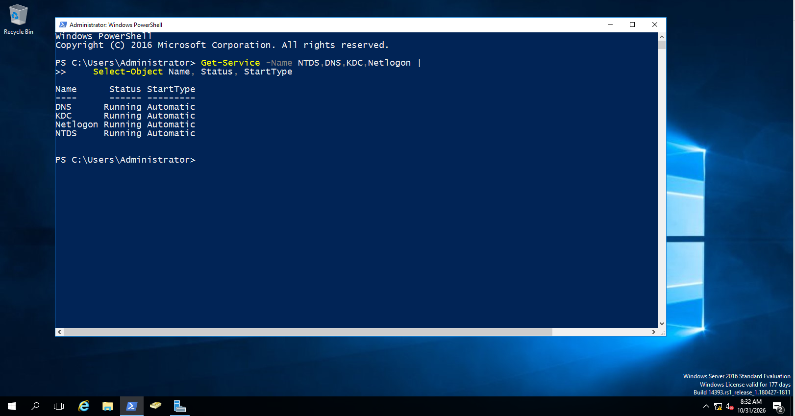
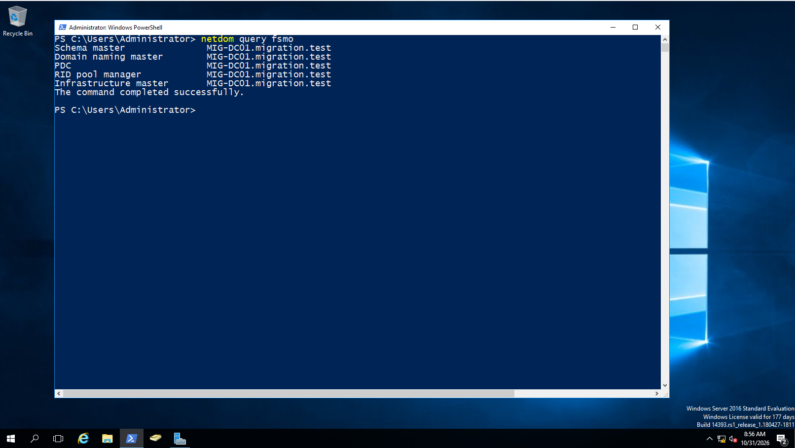
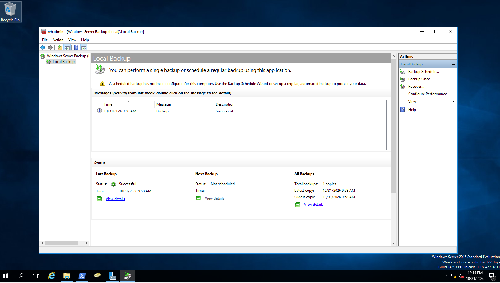
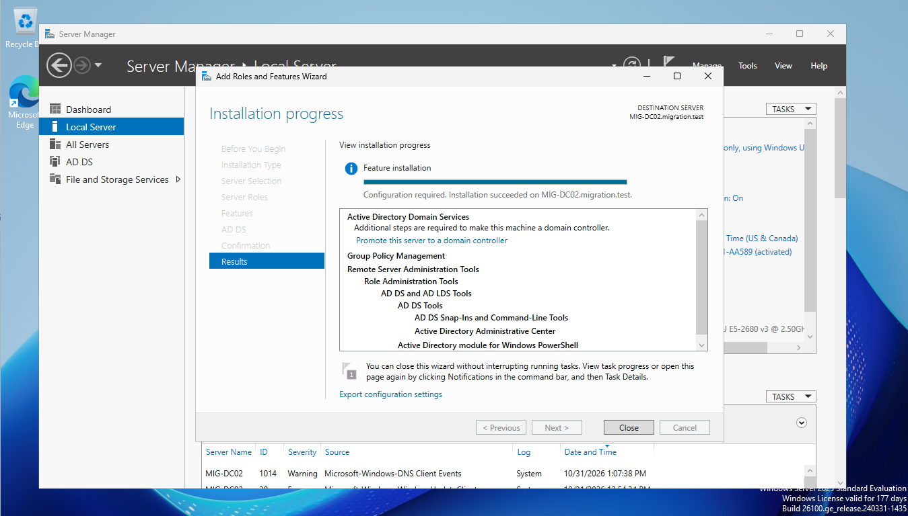
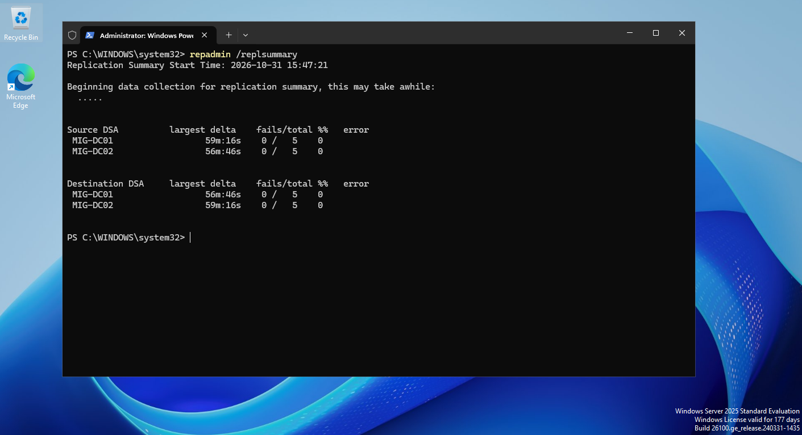
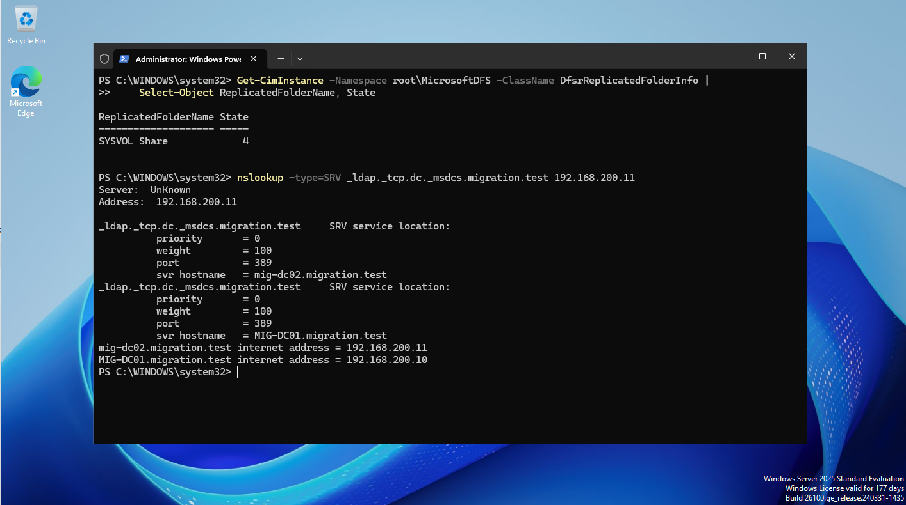
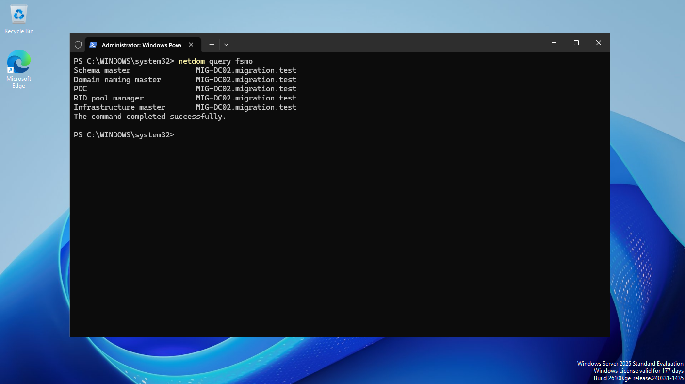
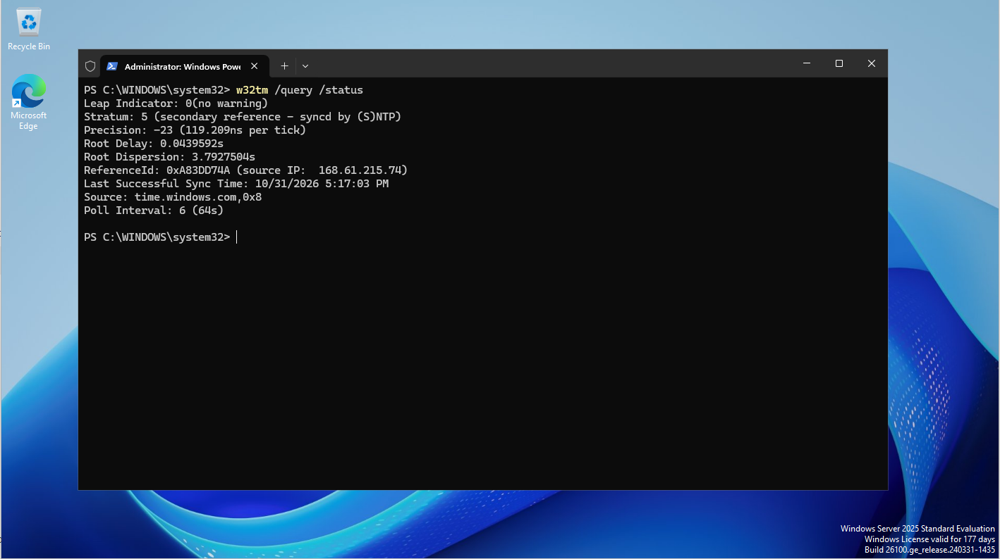
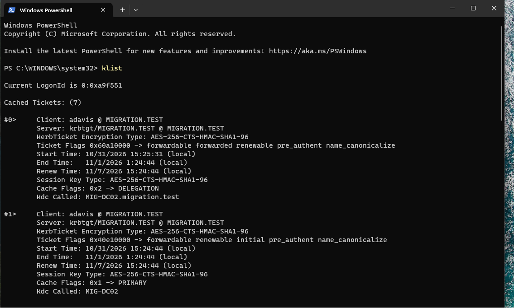

# Enterprise Active Directory Modernization
## Windows Server 2016 → Windows Server 2025 | Side-by-Side Domain Controller Migration

**Project type:** Hands-on infrastructure engineering lab  
**Platform:** Oracle VirtualBox | Windows Server 2016 / 2025 | Windows 11  
**Domain:** `migration.test`  
**Migration approach:** Introduce a new domain controller, replicate, transfer FSMO roles, validate authentication, then gracefully demote the legacy controller  
**Project repository:** https://github.com/dlittle-source/Windows-Server-2016-to-2025-AD-Migration

> **Lab disclosure:** This is an isolated, non-production demonstration of Active Directory modernization. It is not a record of a production customer migration.

## Executive summary

This project demonstrates a side-by-side migration of an existing Active Directory Domain Services (AD DS) environment from a Windows Server 2016 domain controller (**MIG-DC01**) to a Windows Server 2025 domain controller (**MIG-DC02**). The objective was to preserve the existing domain and directory objects while transitioning directory services, DNS, Global Catalog functionality, and all five Flexible Single Master Operations (FSMO) roles to the newer server.

The migration included a successful system-state backup, schema preparation, domain-controller promotion, replication checks, FSMO role transfers, client authentication testing, and graceful demotion of the legacy domain controller. A DNS-related replication failure interrupted the initial demotion attempt; investigation isolated error **8524** for the `ForestDnsZones` partition, and replication succeeded after correcting the legacy controller's DNS client configuration.

The strongest functional test was a **first-time domain logon** by a test user while MIG-DC01 was powered off. Kerberos ticket inspection identified **MIG-DC02** as the issuing KDC and showed AES-256 encryption.

## Problem and objectives

Replacing an aging domain controller requires more than installing a newer Windows Server. The migration must preserve directory identity data and ensure that clients can discover a functioning DC, authenticate, resolve DNS records, and continue to use the domain after the legacy server is removed.

Project objectives:

- Preserve the existing `migration.test` domain rather than creating a replacement forest.
- Establish a Windows Server 2025 writable domain controller with DNS and Global Catalog functionality.
- Verify directory replication and transfer all five FSMO roles.
- Validate domain-controller discovery and live Kerberos authentication without relying on cached credentials.
- Demote the Windows Server 2016 domain controller gracefully, rather than forcing removal.
- Record operational exceptions and outstanding checks accurately.

## Architecture

### Before migration

```text
Oracle VirtualBox — NatNetwork (192.168.200.0/24)
Gateway: 192.168.200.1

MIG-DC01 | Windows Server 2016 | 192.168.200.10
  ├─ AD DS / DNS / Global Catalog
  ├─ All five FSMO roles
  └─ migration.test

MIG-DC02 | Windows Server 2025 | 192.168.200.11
  └─ Domain-joined member server (pre-promotion)

MIG-CL01 | Windows 11 | 192.168.200.100
MIG-CL02 | Windows 11 | 192.168.200.101
```

### After migration

```text
migration.test
  └─ MIG-DC02 | Windows Server 2025 | 192.168.200.11
       ├─ Writable AD DS domain controller
       ├─ DNS / Global Catalog
       ├─ Schema Master + Domain Naming Master
       ├─ PDC Emulator + RID Master + Infrastructure Master
       └─ Kerberos authentication and DC locator services

MIG-DC01 | Windows Server 2016
  └─ Successfully demoted to domain member server

MIG-CL01 / MIG-CL02 | Domain-joined Windows 11 clients
```

**Directory structure used for testing:** `Corporate-Users` (IT, Finance, Human-Resources), `Corporate-Groups`, and `Workstations`; test users `jwilson`, `smitchell`, and `adavis`; and matching departmental security groups.

## Implementation and engineering decisions

### 1. Assess and protect the source environment

On MIG-DC01, verified core AD services, DNS SRV records, SYSVOL and NETLOGON shares, and initial FSMO ownership. The DFS Replication (DFSR) SYSVOL replicated-folder state was **4 (Normal)**. The initial `dcdiag /q` output also included DFSREvent and SystemLog warnings associated with earlier VM shutdown and startup events; the baseline was **not** represented as error-free.

A dedicated 40 GB virtual disk was attached to MIG-DC01 and formatted as an NTFS backup volume. Windows Server Backup completed a **System State backup** on October 31, 2026 (approximately **11.67 GB** transferred). This provided a lab recovery checkpoint, but the backup disk remained on the same physical VirtualBox host and was **not** an independent off-host disaster-recovery copy. No restore test was recorded.





### 2. Promote Windows Server 2025 into the existing domain

Installed the AD DS role on MIG-DC02 and promoted it as an additional **writable** domain controller in `migration.test`, with DNS and Global Catalog services. The promotion workflow included forest/schema and domain preparation. The AD schema object version was subsequently verified as **91**. This schema update is distinct from raising the domain or forest functional level; a Windows Server 2025 functional-level upgrade is **not claimed** here.

Validated NTDS, DNS, KDC, and Netlogon services; SYSVOL/NETLOGON shares; DFSR SYSVOL state; and DNS SRV records. While both controllers were online, `repadmin /replsummary` showed **0 failures out of 5** for each controller in the recorded check.





### 3. Transfer FSMO roles and configure time synchronization

Transferred all five FSMO roles to MIG-DC02 using Microsoft management consoles, then verified ownership with:

```powershell
netdom query fsmo
```

The output identified `MIG-DC02.migration.test` as Schema Master, Domain Naming Master, PDC Emulator, RID Master, and Infrastructure Master.

Because the PDC Emulator is important to domain time hierarchy, configured MIG-DC02 to synchronize with an external time source in this lab. `w32tm /query /status` subsequently reported `time.windows.com,0x8` as the source. A production implementation would use an organization-approved, resilient time source and monitoring configuration.




### 4. Validate client discovery and Kerberos authentication

Updated MIG-CL01's DNS client configuration to use MIG-DC02 (`192.168.200.11`) and verified LDAP connectivity to the new controller. Temporarily powered off MIG-DC01, then used:

```powershell
nltest /dsgetdc:migration.test /force
```

DC locator selected **MIG-DC02**. A test user (`adavis`) successfully signed in to MIG-CL01 **for the first time** while the old controller was unavailable. Because the account had not previously logged on to that client, this provided stronger evidence of live domain authentication than a previously cached sign-in.

The `klist` output showed a ticket-granting ticket for `krbtgt/MIGRATION.TEST`, with **MIG-DC02** as KDC and **AES-256-CTS-HMAC-SHA1-96** encryption.



## Troubleshooting case study: demotion blocked by DNS replication failure

The first normal demotion attempt for MIG-DC01 failed while transferring remaining data in the `ForestDnsZones` application partition. The wizard reported that the directory service could not determine ownership of floating single-master operation roles. Rather than force demotion, FSMO ownership and partition replication were investigated.

**Investigation:**

```powershell
netdom query fsmo
repadmin /showrepl MIG-DC01 "DC=ForestDnsZones,DC=migration,DC=test"
Get-DnsClientServerAddress -AddressFamily IPv4
```

- `netdom` confirmed that all five FSMO roles were already held by MIG-DC02.
- `repadmin /showrepl` showed **error 8524 (DNS lookup failure)** for inbound replication from MIG-DC02 to MIG-DC01.
- MIG-DC01's IPv4 DNS client configuration still referenced its own legacy address (`192.168.200.10`).

**Corrective action:** Changed MIG-DC01's preferred DNS server to the new controller (`192.168.200.11`) and explicitly retried replication:

```powershell
repadmin /replicate MIG-DC01 MIG-DC02 "DC=ForestDnsZones,DC=migration,DC=test"
```

The command returned **“Sync from MIG-DC02 to MIG-DC01 completed successfully.”** A subsequent **normal demotion** of MIG-DC01 completed and the server restarted as a member server.

**Engineering lesson:** A migration can have correct FSMO ownership while still being blocked by application-partition replication and name resolution. Validate DNS client configuration and partition-level replication before attempting to retire a domain controller. The recorded sequence supports DNS configuration as the effective corrective action; it does not prove that every possible underlying cause was independently ruled out.

## Validation results

| Check | Recorded result | Status |
|---|---|---|
| Source DC system-state backup | Windows Server Backup reported success | Passed |
| New DC AD DS/DNS/KDC/Netlogon | Services running | Passed |
| SYSVOL and NETLOGON shares | Present on MIG-DC02 | Passed |
| DFSR SYSVOL | State 4 (Normal) | Passed |
| AD replication (while both DCs online) | 0/5 failures in each direction | Passed at time checked |
| FSMO roles | All five on MIG-DC02 | Passed |
| PDC time source | External time source reported by `w32tm` | Passed in lab |
| DC discovery without MIG-DC01 | MIG-DC02 selected | Passed |
| First-time test-user sign-in | Successful with MIG-DC01 powered off | Passed |
| Kerberos ticket inspection | MIG-DC02 KDC; AES-256 TGT | Passed |
| Graceful legacy DC demotion | Completed successfully | Passed |
| Post-demotion DC inventory | Only MIG-DC02 listed | Passed |
| Post-demotion DNS SRV lookup | Only MIG-DC02 returned | Passed |
| Post-demotion `dcdiag /q` | Historical DFSREvent/SystemLog warnings present | Follow-up monitoring |
| MIG-CL02 DNS client settings | Not conclusively revalidated after demotion | Outstanding |
| Backup restoration | Not tested | Not performed |

After demotion, the new controller's DNS SRV lookup returned only MIG-DC02 and the AD domain-controller inventory showed only MIG-DC02. A direct query of MIG-DC02's `_msdcs` GUID CNAME record also resolved successfully. However, `dcdiag /q` still surfaced historical DFSR/SystemLog events, including KDC Event ID 37 and DNS registration warnings. A subsequent scoped query found no matching new KDC Event ID 37 entries after the checked cutoff time; this is **not** represented as permanent elimination of the issue.

## Lessons learned

1. **Treat DNS as a migration dependency, not a background service.** DC locator, replication, and demotion depend on reliable name resolution.
2. **Verify application partitions explicitly.** A general replication summary is useful but does not replace targeted checks when a specific partition fails.
3. **Validate authentication with the old DC unavailable.** A first-time logon and Kerberos ticket evidence are stronger than merely observing that a client is domain joined.
4. **Keep the demotion graceful when possible.** Troubleshoot replication before resorting to forced removal.
5. **Separate completed results from outstanding work.** Diagnostic warnings, off-host backup protection, and secondary-client DNS verification remain meaningful operational considerations.

## Screenshot evidence

The repository's [`screenshots/`](screenshots/) directory contains 17 captured images covering source health, backup, AD DS deployment, replication, DNS, FSMO transfer, time synchronization, and client Kerberos validation. Screenshots are supporting evidence; additional post-demotion results are documented from recorded command outputs rather than represented as screenshots.

## Final outcome and next steps

The existing `migration.test` domain was successfully transitioned to **MIG-DC02 running Windows Server 2025**, with all five FSMO roles transferred, live client authentication demonstrated, and the Windows Server 2016 domain controller gracefully demoted. The lab VMs were shut down and preserved for future review.

**Remaining follow-up:** Confirm MIG-CL02 uses the new DNS server, review historical diagnostic events in a fresh health-check window, and consider an independent backup copy plus a controlled restore exercise for a more production-like recovery assessment. Any future functional-level change should be performed as a separate, explicitly validated task.

---

**Skills demonstrated:** Active Directory Domain Services · Windows Server modernization · DNS/DC Locator · DFS Replication · FSMO role management · Kerberos · PowerShell diagnostics · Windows Server Backup · Domain controller lifecycle management · Root-cause investigation · Technical documentation

## Technical Documentation

For detailed migration procedures, PowerShell commands, validation results, FSMO role transfers, Kerberos authentication testing, and DNS replication troubleshooting, see the [Technical Migration Report](docs/TECHNICAL-MIGRATION-REPORT.md).

